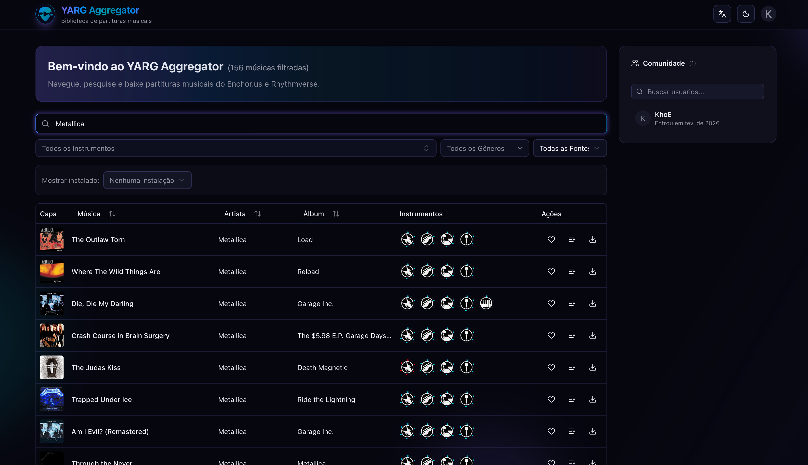

# YARG Content Aggregator

The **YARG Content Aggregator** indexes and serves music charts for **Yet Another Rhythm
Game (YARG)**. It fetches charts from [Enchor.us](https://enchor.us) and
[Rhythmverse](https://rhythmverse.co), stores their metadata in PostgreSQL and gives you
one fast, searchable library.

> [!NOTE]
> This is a community-made tool and is not affiliated with the YARG project.



## Features

- **Unified search** across Enchor and Rhythmverse, with fuzzy, word-order-independent
  matching ("Park Linkin" finds Linkin Park)
- **Filters** by instrument difficulty (guitar, bass, drums, keys, vocals), genre, source
  and installed status
- **Resilient provider fetching**: pages are saved as they arrive; rate limits are
  detected and respected; failed pages are tracked and re-fetched so nothing is missed;
  a live view shows progress, retries and history (admin → Providers)
- **YARG integration**: read your game's cache file to see which songs you have installed,
  across several installations
- **Accounts**: email/password, Google, Spotify, Apple and Last.fm sign-in; favorites and
  song lists; import from Spotify / Last.fm
- **7 languages** (English, Spanish, French, German, Japanese, Portuguese, Chinese) and
  light/dark themes

## Tech stack

Next.js 16 (App Router) · React 19 · TypeScript · Tailwind CSS 4 + Shadcn UI · PostgreSQL +
Drizzle ORM · Better Auth · BullMQ + Redis · Docker

Postgres and Redis are **not** part of this repo. They come from the shared
[LocalInfra](https://github.com/LKhoe/LocalInfra) stack, where this app has its own
database role and a Redis user limited to keys starting with `yarg:`.

## Local development

### Prerequisites

- **Node.js 24+** (`.nvmrc` pins the version used here: `nvm use`)
- **Docker Desktop**, to run LocalInfra on the Mac
- [LocalInfra](https://github.com/LKhoe/LocalInfra) cloned at `../../LocalInfra`
  relative to this repo, with its `.env` filled in (see its README)

### 1. Start Postgres and Redis (LocalInfra on Docker Desktop)

```bash
cd ../../LocalInfra
mkdir -p backups-local && touch backups-local/.localinfra-backup-target
BACKUP_DIR=./backups-local DOCKER_CONTEXT=desktop-linux docker compose up -d --build
DOCKER_CONTEXT=desktop-linux scripts/new-project.sh yarg     # prints this app's credentials
cd -
```

`DOCKER_CONTEXT=desktop-linux` matters: if your active Docker context is the Pi
(`docker context show`), a plain `docker compose` would run there.

### 2. Configure

```bash
npm install
```

Create `.env.local` with the values printed by `new-project.sh`, **replacing the
container host names with `localhost`** (the app runs on the Mac, not in Docker):

```env
DATABASE_URL=postgresql://yarg:<password>@localhost:5432/yarg
REDIS_HOST=localhost
REDIS_PORT=6379
REDIS_USERNAME=yarg
REDIS_PASSWORD=<password>
REDIS_KEY_PREFIX=yarg:
BETTER_AUTH_SECRET=<openssl rand -base64 32>
BETTER_AUTH_URL=http://localhost:3000
NEXT_PUBLIC_APP_URL=http://localhost:3000
```

Next.js reads `.env.local` on top of `.env`, so `.env.local` wins where both define a
variable (`.env` holds the Pi's production settings, if you have one). Optional keys
(Google/Spotify/Apple OAuth, Last.fm, YouTube, OpenRouter) are listed in `.env.example`;
leave them out if you don't need those features. Last.fm sign-in is only enabled when
`LASTFM_API_KEY` and `LASTFM_API_SECRET` are set.

### 3. Create the schema

The Docker image runs these on every start; locally you run them yourself:

```bash
node --env-file=.env.local scripts/migrate.mjs      # Drizzle migrations
node --env-file=.env.local scripts/apply-sql.mjs    # extensions, full-text search, trigram indexes
```

### 4. Run

```bash
npm run dev
```

Open http://localhost:3000 and **sign up: the first account becomes admin**. To fill the
library, go to **Admin → Providers** and click the download button on Enchor.us or
Rhythmverse. The first fetch reads the whole listing (Enchor ~80 pages, Rhythmverse ~400),
later ones only what changed.

## Scripts

| Command | Description |
|---------|-------------|
| `npm run dev` | Development server on port 3000 |
| `npm run build` | Production build |
| `npm run start` | Serve the production build |
| `npm run lint` | ESLint |
| `npm run db:generate` | Generate a Drizzle migration after changing `lib/db/schema.ts` |
| `npm run db:studio` | Drizzle Studio (`DATABASE_URL` must be set in the shell) |
| `node --env-file=.env.local scripts/migrate.mjs` | Apply migrations |
| `node --env-file=.env.local scripts/apply-sql.mjs` | Apply the search/extension SQL |

## Using it

- **Search**: type song, artist or album; word order doesn't matter.
- **Filters & sort**: instrument difficulties, genre, source, installed only; sort by
  any column.
- **Fetching charts** (admins): Admin → Providers. Per source you can fetch new charts,
  run a full refetch, stop a running fetch, retry failed pages or resume a stopped run.
  The page map, rate-limit countdown and activity log show what is happening.
- **YARG integration**: add a game installation and upload its cache file to mark the
  songs you already have.

## Deployment

It runs on a Raspberry Pi with umbrelOS, deployed from the Mac through a Docker context.
See **[DEPLOY.md](DEPLOY.md)**.

## Project structure

```
app/                    Next.js App Router (pages + API routes under app/api/)
components/             React components (ui/ = Shadcn, providers/ = fetch control panel, ...)
lib/
  db/                   Drizzle schema, migrations/, setup/ (search SQL)
  services/             business logic (music search, providers, ...)
  auth.ts               Better Auth config
  queue.ts              BullMQ queue + worker for provider fetches
  redis.ts              Redis clients (keys/channels namespaced by REDIS_KEY_PREFIX)
services/
  providers/            Enchor + Rhythmverse adapters, rate-limited HTTP client, fetch runner
  songs/                song normalisation, dedup and saving
  cache-reader/         YARG cache file parser
messages/               translations (7 languages)
scripts/                migrate.mjs / apply-sql.mjs (also used by the Docker entrypoint)
```

## Contributing

Run the linter before opening a PR:

```bash
npm run lint
```
